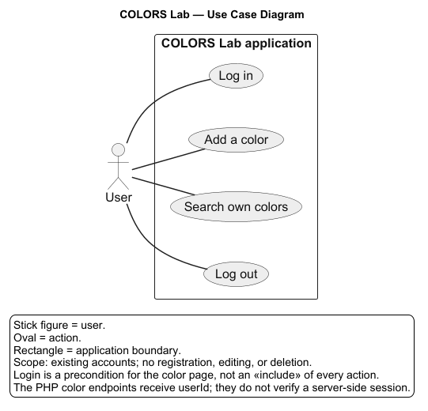
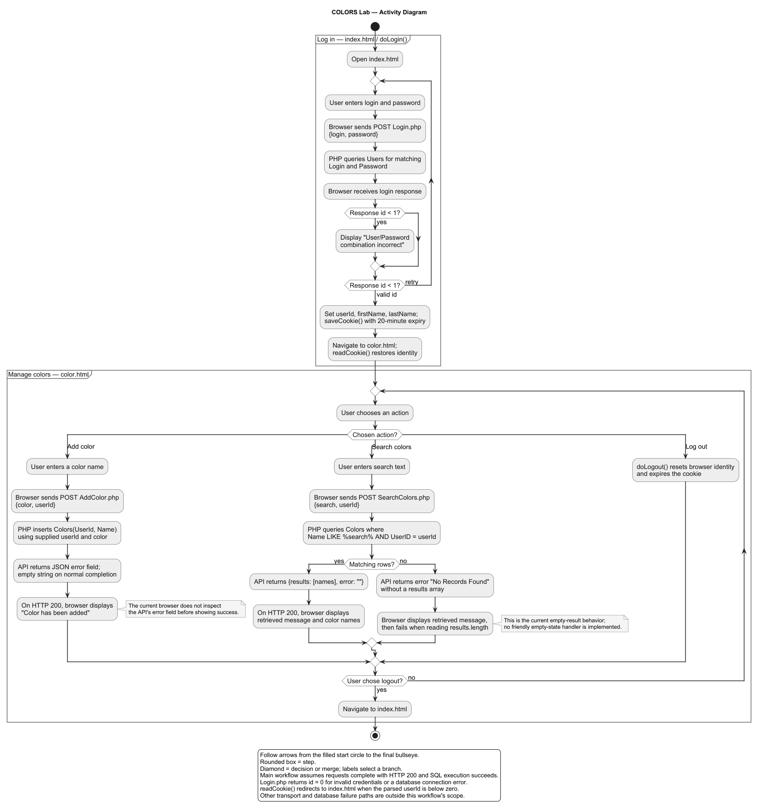
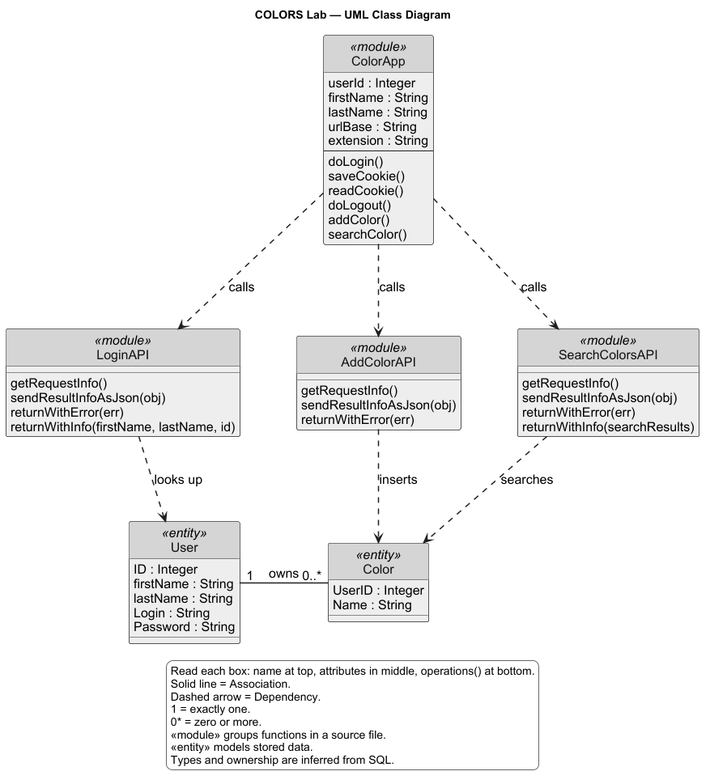

# COLORS Lab UML diagrams

These diagrams describe the implementation in this repository. Each diagram has
an editable PlantUML source (`.puml`) and a rendered PNG.
The class diagram follows the supplied lecture examples: gray boxes with name,
attribute, and operation compartments, plus standard UML relationship lines.

| Diagram | Source | PNG |
| --- | --- | --- |
| Use case | [usecase.puml](usecase.puml) | [usecase.png](usecase.png) |
| Activity | [activity.puml](activity.puml) | [activity.png](activity.png) |
| Class | [class.puml](class.puml) | [class.png](class.png) |

Start with the [reading guide](READING-GUIDE.md) for a walkthrough of all three
diagrams, the class-box-to-file mapping, and the relationship symbols in the
reference images.

## Scope and interpretation

- The supplied submission screenshot requires `docs/uml`, diagram sources,
  rendered diagrams, and the URL of the final GitHub commit. It mentions use case,
  activity, and class diagrams as examples; it does not provide a detailed grading
  rubric. All three types are included here.
- Supported actions are login, add a color, search a user's colors, and logout.
  There are no registration, update, or delete features in the supplied code.
- The application is procedural JavaScript and PHP. The class diagram models
  file-level state and functions as `<<module>>` classifiers and database records
  as conceptual `<<entity>>` classes; it does not claim the code defines classes.
- The database attributes come from the actual SQL in `LAMPAPI`. Attribute types
  and the user-to-color multiplicity are inferred. No database schema was
  supplied, so primary/foreign-key enforcement and additional columns are not
  asserted. The SQL spells the color ownership column both `UserId` and `UserID`.
- Cookie identity is a browser workflow mechanism. The PHP color endpoints use
  the submitted `userId` without checking a server-side session.
- The activity diagram shows the normal request flow plus invalid login and
  empty search results. It preserves the current behavior: `addColor()` displays
  success on HTTP 200 without checking `error`; an empty search response lacks
  `results`, which causes `searchColor()` to fail at `results.length` after setting
  the retrieved message. These diagrams do not silently assume fixes.
- Login sends the password directly. The MD5 calls in `doLogin()` are commented
  out, so hashing is not represented as an active step.

## Implementation references

| File | What it establishes |
| --- | --- |
| [index.html](../../index.html) | Login form and `doLogin()` event |
| [color.html](../../color.html) | Cookie loading; add, search, and logout controls |
| [js/code.js](../../js/code.js) | Browser state, cookies, navigation, POST requests, and response handling |
| [LAMPAPI/Login.php](../../LAMPAPI/Login.php) | Credential lookup and login response |
| [LAMPAPI/AddColor.php](../../LAMPAPI/AddColor.php) | User-associated color insertion |
| [LAMPAPI/SearchColors.php](../../LAMPAPI/SearchColors.php) | Substring search filtered by user ID |

## Regenerating the images

With Java and the official [PlantUML renderer](https://plantuml.com/download)
available, run these commands from the repository root. Replace
`path/to/plantuml.jar` with the location of your renderer.

```text
java -jar path/to/plantuml.jar -charset UTF-8 -tpng "docs/uml/*.puml"
```

The class and use case diagrams use the default Graphviz engine; install
Graphviz if it is not included with your PlantUML distribution. Images were
generated with PlantUML 1.2026.9. SVG is optional and is not required by the
provided submission instructions. To generate it, replace `-tpng` with `-tsvg`.

## Submission

Upload the complete `docs/uml` directory to the same GitHub repository as the
COLORS Lab. After all diagrams have been committed, submit the final commit's
URL, in this format:

```text
https://github.com/<owner>/<repository>/commit/<full-commit-sha>
```

This working folder was supplied without a `.git` directory. No commit, push,
or final commit URL has been created as part of preparing these artifacts.

## Diagram previews

### Use case



### Activity



### Class


